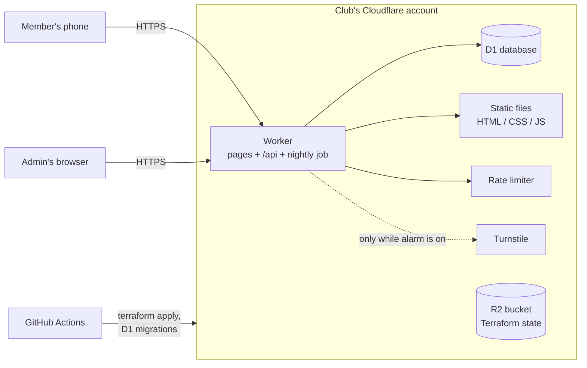

# Architecture and D1 schema

Status: **approved 2026-11-26, with changes (folded in below).** Built in the PRs listed in section 12.
`CLAUDE.md` holds the requirements; this document says how we'll meet them. Choices the
brief didn't settle are marked **(my call)**. Ones settled at approval are marked
**(decided)**.

## 1. The big picture

Everything lives in the club's own Cloudflare account and is created by Terraform. There is
one Worker. It serves the pages, answers the `/api/*` calls those pages make, and runs a
nightly clean-up job. It keeps its data in one D1 database.



What happens on every request:

1. The request reaches the Worker first, every time, including requests for plain pages
   (`run_worker_first = true`).
2. If it's a private page and there's no valid login, the Worker sends the person to the
   login page. Public pages are `/`, `/rules` and the login pages.
3. If it's an `/api/*` call, the Worker checks the login, CSRF protection and input, then
   talks to D1.
4. Otherwise it hands back the static file.
5. On the way out, the Worker adds the security headers to every response: pages, API
   answers, redirects and errors alike.

### Checked against the docs

| Question | Answer | Source |
|---|---|---|
| Can Terraform upload the static files? | Yes: `cloudflare_workers_script` has `assets.directory` (provider v5.29.0). No bundling fallback needed. | github.com/cloudflare/terraform-provider-cloudflare, `docs/resources/workers_script.md` |
| Do `_headers` rules cover Worker responses? | No, only static files. That's one reason the Worker runs first and sets headers itself. | developers.cloudflare.com/workers/static-assets/headers/ |
| PBKDF2 iteration cap | 100,000, hard-coded in the runtime. Its own comment says this is "*WAY* below the recommended minimum". | github.com/cloudflare/workerd, `src/workerd/io/limit-enforcer.h` |
| CPU per request | Free: 10 ms. Paid: 30 s by default, up to 5 min. | developers.cloudflare.com/workers/platform/limits/ |
| Is a D1 batch all-or-nothing? | Yes. A batch is one SQL transaction; if one statement fails, the whole batch rolls back. | developers.cloudflare.com/d1/worker-api/d1-database/ |
| Foreign keys enforced? | Yes, by default, in queries and migrations. | developers.cloudflare.com/d1/sql-api/foreign-keys/ |
| Can Terraform create the tables? | No. Terraform creates the database. Tables come from SQL migration files applied with `wrangler d1 migrations apply`. | developers.cloudflare.com/d1/reference/migrations/ |
| Backups | D1 Time Travel can restore to any minute in the last 30 days (Paid plan). | developers.cloudflare.com/d1/reference/time-travel/ |
| Rate-limiter binding | Approximate, counted per Cloudflare location, windows of 10 or 60 s only. Fine as a flood gate, not for lockouts. | developers.cloudflare.com/workers/runtime-apis/bindings/rate-limit/ |

## 2. Approaches considered

**Stopping double bookings in the database.** Picked: **A**.

- **A. One row per taken 15-minute slot, with a unique key, filled by the database itself.**
  A `booking_slots` table holds one row for each 15-minute block a booking covers, and it
  refuses a second row for the same resource and start time. A trigger fills in those rows
  whenever a booking is added and removes them when it's cancelled, so the app can't forget
  a slot. If two members tap "Book" at the same moment, the database accepts one and refuses
  the other. Cost: a few more rows (a 2-hour booking is 8 rows), which is nothing at our size.
- **B. Same slot table, but the app writes the slot rows itself.** Simpler SQL, but safety
  then depends on every piece of booking code getting the slot list exactly right.
- **C. No slot table; a trigger checks for overlapping times.** Fewer rows, but an overlap
  check is easier to get subtly wrong and harder to explain.

**Keeping the pepper secret.** Picked: **A**.

- **A. A Worker secret, set once by hand with `wrangler secret put`.** Terraform is told to
  leave existing secrets alone (`keep_bindings = ["secret_text"]`). The pepper is never in
  the repo, D1, or Terraform state.
- **B. Cloudflare Secrets Store, set by hand, which Terraform links by name only.** This also
  keeps the value out of state. It's the fallback if A misbehaves (see section 9).
- **C. Terraform-managed secret.** Rejected: the value would sit in the Terraform state file.

**Serving the pages.** Picked: **A**.

- **A. The Worker runs first for every request** and fetches static files through the
  `ASSETS` binding. One place sets all headers and checks logins. The login page's CSP can
  allow Turnstile only while the alarm is on.
- **B. Cloudflare serves static files directly, with headers from a `_headers` file.**
  Headers would live in two places, logged-out visitors couldn't be redirected, and the
  static rules can't change with the alarm.

## 3. Repository layout (my call)

```
CLAUDE.md                 brief (source of truth)
README.md                 setup, admin how-tos, threat model, "How to book" guide
docs/architecture.md      this document
clubs/pastime/club.json   the club's settings: name, contact, areas, rooms, limits, rules, colors
clubs/pastime/pages/      the club's page text (placeholders); drafts/ is local only, gitignored
infra/                    Terraform: Worker, D1, cron, Turnstile, workers.dev route
worker/
  src/                    Worker code (plain JavaScript modules)
  public/                 static pages, CSS, browser JS
  migrations/             D1 schema as numbered SQL files (0001_init.sql, ...)
  test/                   tests that run inside the real Workers runtime
  wrangler.jsonc          used for local dev, bundling and migrations only, never to deploy
  package.json, package-lock.json
.github/workflows/        ci.yml, deploy.yml, drift-check.yml
.github/dependabot.yml
```

- **Plain JavaScript with `// @ts-check` and JSDoc types (decided).** Every file starts with
  `// @ts-check`, and types are written as JSDoc comments, for example
  `/** @param {string} pin */`. Nothing is compiled, so the code that runs is the code you
  read. CI runs `tsc --noEmit` to check the types and fails the PR on any type error. Types
  for the Workers runtime and our bindings come from `wrangler types`.
- **No npm packages at runtime (my call).** The Worker uses only built-in Web APIs:
  `crypto.subtle`, `Intl` and `fetch`. npm is for development only: `wrangler` (local dev,
  bundling, migrations, types), `typescript` (type checking only), and `vitest` with
  `@cloudflare/vitest-plugin` (tests; formerly `vitest-pool-workers`). This keeps supply-chain risk close to zero for
  the code that runs live.
- **One settings file per club (decided 2026-11-28).** Everything club-specific lives in
  `clubs/<club>/club.json`, which `worker/src/club.js` imports (Pastime is the first and
  only club). `worker/src/club-config.js` checks it when the Worker starts: only known keys
  (so no secret or throttle value can be added by mistake), booking limits within the
  database's own ceiling (2 hours per booking), and rules whose placeholders are
  filled from the limits. The Worker then fills pages as it serves them (HTMLRewriter, text
  always escaped), and serves `/club.css` (accent colors) and `/js/club.js` (the public
  settings for the page scripts). No inline scripts, so the CSP doesn't change. Resources
  and hours in the file are a starting list, loaded once into an empty site from the admin
  page; after that the admin pages own them. The README explains each setting.
- **The whole club website (built 2026-11-28; `docs/full-site-plan.md`, steps 2 to 4).** The
  Worker fills a shared header (crest, menu) and footer (contact details) into every public
  and member page. The content pages take their text from `clubs/<club>/pages/`, which
  `npm run content` gathers into a generated JSON file. Only an allowed list of plain tags
  gets through, checked by `src/club-content-check.js` at build time and again at start-up.
  Drafts from the club's old site sit in `clubs/<club>/drafts/` (gitignored, local demo
  only).
  - **The week view:** `GET /api/week` (public and read-only, `src/week.js`) returns seven
    days of 15-minute slots for one area. Each slot is one character: free, taken, closed,
    past, later, or a program letter. It never includes members, admin labels or private
    league names. `public/js/week.js` draws it: seven columns on wide screens, one swipeable
    day with tabs on phones, and a booking sheet in a `<dialog>`. Positions are set through
    CSSOM, which the strict CSP allows. Bookings still go through `POST /api/bookings` and
    every server and database check.
  - **Migration `0002`:** `resources.area` (the area id from the club's settings) and
    `leagues.public` (a program, shown by name). Both are additive, with defaults.
  - **Lanes (migration `0004`):**
    - A booking on several lanes is one row per lane. The first row leads (`group_id`
      NULL), and the others point at it. All the rows go in one D1 batch (one
      transaction), so it's all or nothing, and the slot table still stops double
      bookings.
    - Members see, cancel and export a group as one booking, and the booking limit counts
      only the lead row.
    - Admins can book a whole area at once (the same grouping), and `leagues.whole_area`
      books every lane each week.
    - The week view counts free lanes per hour in the browser (`public/js/lanes.js`) from
      the same public per-lane data.
- **Bundling.** Terraform's `content_file` takes one file, so CI runs
  `wrangler deploy --dry-run --outdir dist` to bundle `src/` into one file. Terraform
  uploads that file. Terraform owns the Worker; `wrangler deploy` is never run for real.

## 4. Infrastructure (Terraform, `infra/`)

Same pattern as the portfolio repo: provider `cloudflare/cloudflare ~> 5.29`, state in an R2
bucket through the S3 backend with `use_lockfile = true`, and credentials from environment
variables.

| Resource | What it does |
|---|---|
| `cloudflare_d1_database` | The database. |
| `cloudflare_workers_script` | The Worker: bundled code, `assets.directory = worker/public`, `run_worker_first = true`, bindings below, `keep_bindings = ["secret_text"]`. |
| `cloudflare_workers_script_subdomain` | Turns on the `*.workers.dev` address. |
| `cloudflare_workers_cron_trigger` | Nightly clean-up at `0 8 * * *` UTC (3–4 a.m. club time). |
| `cloudflare_turnstile_widget` | The challenge widget, scoped to our hostname. |

Worker bindings:

| Binding | Type | Set by |
|---|---|---|
| `DB` | D1 | Terraform |
| `ASSETS` | static files | Terraform |
| `LOGIN_LIMITER` | rate limit, 60 s window; limit kept private | Terraform, from a sensitive variable |
| `THROTTLE_SETTINGS` | plain text (JSON); values kept private | Terraform, from a sensitive variable (section 5) |
| `TURNSTILE_SITE_KEY` | plain text (public) | Terraform |
| `TURNSTILE_SECRET` | secret | Terraform or wrangler (see section 9) |
| `PEPPER` | secret, 32 random bytes | **you, once, with `wrangler secret put`** |
| `IP_HASH_KEY` | secret, 32 random bytes | **you, once, with `wrangler secret put`** |
| `ADMIN_SETUP_TOKEN` | secret, temporary | you, only while enrolling admins; deleted afterwards |

**Manual steps (decided).** Three things are done by hand, once, and the README will spell
them out: creating the Terraform state bucket (Terraform needs it before it can run), and
setting `PEPPER` and `IP_HASH_KEY` with `wrangler secret put`. Separately, D1 table changes
run through wrangler in the deploy job, because Terraform can't create tables.

**Where Terraform state lives.** In an R2 bucket (Cloudflare's file storage) in the club's
own Cloudflare account. That's the same account as the site, and separate from your
portfolio account. It is private:

- R2 buckets are never public unless someone turns that on
  (developers.cloudflare.com/r2/buckets/public-buckets/). We never do: no `r2.dev` address
  and no custom domain on this bucket. The README's setup steps include checking that both
  are off.
- Everything in R2 is encrypted at rest with AES-256
  (developers.cloudflare.com/r2/reference/data-security/).
- Only two R2 tokens can reach it, both limited to this one bucket: Object Read & Write for
  deploys (a `production` environment secret), and Object Read only for PR plans and the
  drift check.
- Terraform keeps the bucket's `r2.dev` address switched off
  (`cloudflare_r2_managed_domain`), so the weekly drift check reports it if anyone turns it
  on. A custom domain needs a zone, which the account doesn't have yet.

The state never contains `PEPPER` or `IP_HASH_KEY`. It does contain the throttle settings,
and possibly the Turnstile secret, which is one more reason it stays private.

**Spending limit (my call).** Set a Workers spending limit in the dashboard, so a flood of
fake logins can't run up the bill. Each PIN check costs real CPU time.

## 5. Security design

### Secret keys

There are two. Each is 32 random bytes, set once by hand with `wrangler secret put`, and
never stored in the repo, D1 or Terraform state.

- **`PEPPER`** protects PINs and admin passwords. The Worker derives two keys from it with
  HKDF (built into `crypto.subtle`): the *pin key*, mixed into every PIN and admin password
  before hashing, and the *TOTP key*, which encrypts the admins' authenticator secrets in D1
  (AES-GCM).
- **`IP_HASH_KEY`** is used for one thing only: IP addresses are stored as
  `HMAC-SHA256(IP_HASH_KEY, IP)`, never as the raw address (decided). IPv6 addresses are cut
  to their /64 first. Keeping it separate from the pepper means either key can be replaced
  without touching the other.

**Both admins keep a copy of both keys in their password managers (decided).**

- If `PEPPER` is lost or leaks, every PIN and admin password stops working. The fix is a new
  pepper, a full PIN reissue, and re-enrolling both admins.
- If `IP_HASH_KEY` is lost, set a new one. The only effect is that per-IP counts start again
  from zero. If it leaks together with the database, the IPs behind the last 7 days of failed
  logins could be worked out, because there are only about 4 billion IPv4 addresses to try.
  So replace it then too.

### PINs and admin passwords

- Stored as `pbkdf2-sha256$100000$<salt>$<hash>`, with a random 16-byte salt per member.
- What goes into PBKDF2 is `HMAC-SHA256(pin key, PIN)`, so the pepper is applied before
  hashing.
- Comparison is constant-time (`crypto.subtle.timingSafeEqual`).
- An unknown member number still costs one dummy hash, so response timing doesn't reveal
  which numbers exist.
- New PINs are 6 random digits from `crypto.getRandomValues`, with rejection sampling so
  every PIN is equally likely.
- **Demo sites** (`DEMO_MODE` exactly `on`, made-up data only, decided 2026-11-28): 1,000
  rounds instead of 100,000, so a login fits the Free plan's 10 ms of CPU.
  - The count is in each hash, and a check accepts only the site's own count. So a demo
    hash never works at full strength, and the other way round.
  - A hash that's unreadable or has the other count is still hashed once before it's
    refused, so timing doesn't show it.
  - A demo also puts a banner on every page and sends `X-Robots-Tag: noindex, nofollow`.
- Admin passwords: at least 16 characters (my call; use the password manager).

### Login throttling

These checks run in this order, before any hashing, to protect both PINs and CPU time:

1. **Flood gate.** The `LOGIN_LIMITER` binding drops a burst of requests from one IP at
   almost zero cost.
2. **Per-IP block.** An IP with too many failed logins in the past hour can't try again until
   it's back under the limit. IPv6 addresses are grouped by /64, because one attacker usually
   controls a whole /64.
3. **Per-member lockout.** After 5 failures in a row, the account locks: 15 min the first
   time, then 1 hour, then 24 hours (it stays at 24 hours for later rounds). A successful
   login, an admin "clear lockout", or 7 days with no failures resets it. It's never
   permanent.
4. **Club-wide alarm.** The alarm switches on when failed logins across the whole club cross
   either a short-window limit (minutes) or a long-window limit (a day). It stays on for a
   set time after the last crossing. While it's on, every login is slowed by an extra delay,
   the login page shows and requires Turnstile, and the admin page shows a warning. Each time
   it switches on, an entry goes in the audit log, so you can see its history. The long-window
   limit catches slow attacks that stay under the short one.

Admin logins go through the same checks, with their own lockout counters.

**Configurable thresholds (decided).** The flood-gate rate, the per-IP limit, and the
alarm's limits, hold time and delay are Worker settings, not code. Their values are
deliberately not published, in this document or anywhere in the repo, so nobody can tune an
attack to stay just under them. How that works:

- The values sit in two Terraform variables, marked `sensitive`, supplied from GitHub
  repository secrets (`THROTTLE_SETTINGS`, `LOGIN_FLOOD_LIMIT`). *Changed in the member-login
  PR from "environment secret": the PR plan and the weekly drift check need the same values
  as the deploy, or every plan would show a difference.* Terraform then hides them in plan
  output, which matters because Actions logs on a public repo can be read by anyone.
  Terraform passes them to the Worker as the `THROTTLE_SETTINGS` binding and the
  `LOGIN_LIMITER` limit.
- Terraform checks their shape (positive whole numbers, all keys present) without the check
  itself revealing them.
- If the setting is missing or invalid, the Worker refuses logins with "Login is temporarily
  unavailable" rather than guessing. Tests cover that case.
- Local development and tests use their own made-up values, never the real ones.

The per-member lockout (5 tries; 15 min, 1 h, 24 h) stays fixed and public. Members need to
know how it works, and it's already in the brief.

### Sessions

- **Member sessions:** a random 32-byte token in the `__Host-session` cookie (`Secure`,
  `HttpOnly`, `SameSite=Strict`, `Path=/`), lasting 30 days from login.
- **Admin sessions:** `__Host-admin` cookie, 12 hours.
- D1 stores only a SHA-256 hash of each token, so a database copy can't be used to log in.
- Disabling a member or resetting their PIN deletes all their session rows, which logs them
  out everywhere. Disabled members can't log in, and every request re-checks that the member
  is still active.

### Admin login and enrolment

- Admins sign in with username, password and a 6-digit TOTP code. A code can't be reused
  (`totp_last_step`).
- **First-time setup (my call):** you set a temporary `ADMIN_SETUP_TOKEN` secret, open
  `/admin/setup`, enter the token, choose a password, and add the shown key to your
  authenticator app. The key is typed in or opened as an `otpauth://` link; there's no QR
  code, to avoid a library. Setup works only while that secret exists and fewer than 2
  admins exist. You delete the secret once both admins are enrolled.
- If one admin loses their password or authenticator, the other can reset them. If both do,
  repeat setup.

### CSRF

GET requests never change anything. Every request that does (POST, PUT, PATCH, DELETE)
must pass all three checks:

1. The `Origin` header equals our own origin.
2. An `X-CSRF-Token` header matches the token stored with the session. The page gets it from
   `GET /api/me`.
3. The body is `Content-Type: application/json`.

The login request has no session yet, so it gets checks 1 and 3. `SameSite=Strict` is a
fourth layer on top. (OWASP CSRF Prevention Cheat Sheet.)

### Headers (on every response)

```
Content-Security-Policy: default-src 'none'; script-src 'self'; style-src 'self';
  img-src 'self'; font-src 'self'; connect-src 'self'; form-action 'self';
  frame-ancestors 'none'; base-uri 'none'
Strict-Transport-Security: max-age=31536000
X-Frame-Options: DENY
X-Content-Type-Options: nosniff
Referrer-Policy: no-referrer
Permissions-Policy: camera=(), microphone=(), geolocation=(), payment=(), usb=()
Cross-Origin-Opener-Policy: same-origin
Cross-Origin-Resource-Policy: same-origin
Cache-Control: no-store            (API responses and private pages)
```

Only while the alarm is on, the login page's CSP also allows
`https://challenges.cloudflare.com` in `script-src` and `frame-src`.

### Code rules, enforced by checks in CI

- SQL only through `prepare(...).bind(...)`. CI fails if a template string (`` `${` ``) shows
  up inside `prepare(`.
- Browser code writes data with `textContent` only. CI fails on `innerHTML` and
  `insertAdjacentHTML`.
- Every handler validates its input by hand (type, length, format) and rejects unknown
  fields.
- Bookings are never written with `INSERT OR IGNORE` or `INSERT OR REPLACE`. Those would
  change how the slot trigger handles conflicts. The schema also guards against this
  (section 7), and a test proves it.

## 6. How the booking rules are enforced

| Rule | Where |
|---|---|
| No double booking | **Database**: `booking_slots` primary key, filled by trigger |
| 15-minute blocks; ends after it starts | **Database**: `CHECK` on `bookings` |
| Member booking max 2 hours | **Database**: `CHECK` on `bookings` |
| The club's booking limit: none, N upcoming, or N hours in any 7 days (was: max 2 upcoming) | **Worker**, in the same statement that saves the booking (`src/bookings.js`); the 0001 trigger's count was removed by migration 0003 |
| Suspended or disabled members can't book | **Database**: trigger (also shown in the page) |
| Members can only book slots that haven't started | **Database**: `CHECK` |
| Up to 30 days ahead | Worker. Precisely: any slot on or before the club date 30 days from today (my call). |
| Within open hours | Worker (needs club-time conversion) |
| Cancel only 24 h or more before start | Worker. Admins skip this check. |
| Bookings can't be edited, only cancelled and rebooked | **Database**: trigger |

**Time.** Every time is stored as Unix seconds in UTC. Open hours, league times and "club
dates" are stored as local `HH:MM` / `YYYY-MM-DD` and converted with
`Intl.DateTimeFormat(..., { timeZone: 'America/New_York' })` for each date. That keeps them
right across daylight saving changes. 15-minute boundaries are the same in UTC and New York
time, because the offset is always whole hours. Open hours must sit within one day (no
past-midnight ranges), so the 1–3 a.m. clock-change hour doesn't affect normal hours.

**Admins override member rules (my call on scope):** admin bookings and leagues ignore the
2-hour cap, the 2-booking cap, the 30-day window and open hours. They can't override the
no-double-booking rule: to take over a member's time, an admin cancels that booking first.
A single admin booking is capped at 30 days long. For a longer closure, make two.

**Leagues.** A league is a season: one resource, one weekday, start and end time, first and
last date. The last date can be at most 12 months after the day it's created. For two
weekdays, create two leagues (my call). When it's created, the Worker:

1. works out every date in the season;
2. checks which dates already have a booking in that time;
3. in one batch, adds a league booking for every free date and records each clashing date
   in `league_skips`;
4. shows you the clash list.

If a member books one of those times in the split second between steps 2 and 3, the batch
fails as a whole and the Worker starts again from step 2. **Renew** creates the next season
as a new league row linked to the old one (`renewed_from`). Cancelling a league cancels its
future dates.

**Suspension.** One batch does three things: adds the suspension, cancels the member's
upcoming bookings (marked `cancelled_by = 'suspension'`), and writes audit entries listing
each cancelled booking. "Suspended until [date]" means through the end of that club date
(my call). Only one active suspension at a time; to change it, lift it and suspend again.

**Add to calendar.** `GET /api/bookings/:id/ics` returns an `.ics` file in UTC with a
reminder 1 hour before (my call). It works only for the member's own booking.

**PIN import and reset.** The admin page sends the CSV in chunks of about 25 members, so
each request stays well inside the CPU limit. The server returns the new PINs once, with
`no-store`, and never keeps them. The page builds the printable sheet in memory. If the tab
closes before printing, those members need a reset. The page warns about this.

## 7. D1 schema (first migration, `0001_init.sql`)

Conventions: `STRICT` tables (SQLite rejects wrong types); `*_at` columns are Unix seconds
UTC; `*_local` columns are club time `HH:MM`; `*_date` columns are club dates `YYYY-MM-DD`.

```sql
-- ---------- People ----------

CREATE TABLE members (
  id              INTEGER PRIMARY KEY,
  member_number   TEXT    NOT NULL UNIQUE CHECK (length(member_number) BETWEEN 1 AND 20),
  display_name    TEXT    CHECK (display_name IS NULL OR length(display_name) <= 100), -- admin-only
  pin_hash        TEXT,                    -- NULL until a PIN is issued
  status          TEXT    NOT NULL DEFAULT 'active' CHECK (status IN ('active', 'disabled')),
  failed_logins   INTEGER NOT NULL DEFAULT 0,
  lock_level      INTEGER NOT NULL DEFAULT 0 CHECK (lock_level BETWEEN 0 AND 3),
  locked_until    INTEGER,
  last_failed_at  INTEGER,
  pin_issued_at   INTEGER,
  created_at      INTEGER NOT NULL,
  updated_at      INTEGER NOT NULL
) STRICT;

CREATE TABLE admins (
  id               INTEGER PRIMARY KEY,
  username         TEXT    NOT NULL UNIQUE CHECK (length(username) BETWEEN 3 AND 40),
  password_hash    TEXT    NOT NULL,
  totp_secret_enc  TEXT    NOT NULL,       -- AES-GCM, key derived from PEPPER
  totp_last_step   INTEGER NOT NULL DEFAULT 0,
  status           TEXT    NOT NULL DEFAULT 'active' CHECK (status IN ('active', 'disabled')),
  failed_logins    INTEGER NOT NULL DEFAULT 0,
  lock_level       INTEGER NOT NULL DEFAULT 0 CHECK (lock_level BETWEEN 0 AND 3),
  locked_until     INTEGER,
  last_failed_at   INTEGER,
  created_at       INTEGER NOT NULL,
  updated_at       INTEGER NOT NULL
) STRICT;

-- ---------- Sessions and login protection ----------

CREATE TABLE member_sessions (
  token_hash  TEXT    PRIMARY KEY,         -- SHA-256 of the cookie value, never the value
  member_id   INTEGER NOT NULL REFERENCES members(id) ON DELETE CASCADE,
  csrf_token  TEXT    NOT NULL,
  created_at  INTEGER NOT NULL,
  expires_at  INTEGER NOT NULL
) STRICT;
CREATE INDEX member_sessions_member ON member_sessions(member_id);
CREATE INDEX member_sessions_expires ON member_sessions(expires_at);

CREATE TABLE admin_sessions (
  token_hash  TEXT    PRIMARY KEY,
  admin_id    INTEGER NOT NULL REFERENCES admins(id) ON DELETE CASCADE,
  csrf_token  TEXT    NOT NULL,
  created_at  INTEGER NOT NULL,
  expires_at  INTEGER NOT NULL
) STRICT;
CREATE INDEX admin_sessions_admin ON admin_sessions(admin_id);

CREATE TABLE login_failures (
  id         INTEGER PRIMARY KEY,
  at         INTEGER NOT NULL,
  kind       TEXT    NOT NULL CHECK (kind IN ('member', 'admin')),
  ip_hash    TEXT    NOT NULL,             -- HMAC-SHA256(IP_HASH_KEY, IP or IPv6 /64); never the raw IP
  member_id  INTEGER REFERENCES members(id) ON DELETE SET NULL  -- NULL if no such member
) STRICT;
CREATE INDEX login_failures_at ON login_failures(at);
CREATE INDEX login_failures_ip ON login_failures(ip_hash, at);

CREATE TABLE system_state (                -- e.g. key 'login_alarm_until'
  key         TEXT    PRIMARY KEY,
  value       TEXT    NOT NULL,
  updated_at  INTEGER NOT NULL
) STRICT;

-- ---------- Resources and hours ----------

CREATE TABLE resources (
  id          INTEGER PRIMARY KEY,
  name        TEXT    NOT NULL UNIQUE CHECK (length(name) BETWEEN 1 AND 60),
  active      INTEGER NOT NULL DEFAULT 1 CHECK (active IN (0, 1)),   -- retire, never delete
  sort_order  INTEGER NOT NULL DEFAULT 0,
  created_at  INTEGER NOT NULL,
  updated_at  INTEGER NOT NULL
) STRICT;

CREATE TABLE opening_hours (               -- no row for a weekday = closed that day
  resource_id  INTEGER NOT NULL REFERENCES resources(id) ON DELETE CASCADE,
  weekday      INTEGER NOT NULL CHECK (weekday BETWEEN 0 AND 6),     -- 0 = Sunday
  opens_local  TEXT    NOT NULL CHECK (opens_local  GLOB '[0-2][0-9]:[0-5][05]'
                                       AND substr(opens_local, 4, 2)  IN ('00','15','30','45')),
  closes_local TEXT    NOT NULL CHECK (closes_local GLOB '[0-2][0-9]:[0-5][05]'
                                       AND substr(closes_local, 4, 2) IN ('00','15','30','45')
                                       AND closes_local <= '24:00'),
  CHECK (opens_local < closes_local),
  PRIMARY KEY (resource_id, weekday, opens_local)  -- allows split hours, e.g. 9-12 and 14-20
) STRICT;

-- ---------- Leagues ----------

CREATE TABLE leagues (
  id                   INTEGER PRIMARY KEY,
  name                 TEXT    NOT NULL CHECK (length(name) BETWEEN 1 AND 80),
  resource_id          INTEGER NOT NULL REFERENCES resources(id),
  weekday              INTEGER NOT NULL CHECK (weekday BETWEEN 0 AND 6),
  starts_local         TEXT    NOT NULL CHECK (starts_local GLOB '[0-2][0-9]:[0-5][05]'
                                             AND substr(starts_local, 4, 2) IN ('00','15','30','45')),
  ends_local           TEXT    NOT NULL CHECK (ends_local GLOB '[0-2][0-9]:[0-5][05]'
                                             AND substr(ends_local, 4, 2) IN ('00','15','30','45')
                                             AND ends_local <= '24:00'),
  first_date           TEXT    NOT NULL,
  last_date            TEXT    NOT NULL,   -- at most 12 months after creation (checked by Worker)
  renewed_from         INTEGER REFERENCES leagues(id) ON DELETE SET NULL,
  created_by_admin_id  INTEGER NOT NULL REFERENCES admins(id),
  created_at           INTEGER NOT NULL,
  cancelled_at         INTEGER,
  CHECK (starts_local < ends_local),
  CHECK (first_date <= last_date)
) STRICT;

-- ---------- Bookings ----------

CREATE TABLE bookings (
  id                     INTEGER PRIMARY KEY,
  resource_id            INTEGER NOT NULL REFERENCES resources(id),
  kind                   TEXT    NOT NULL CHECK (kind IN ('member', 'admin', 'league')),
  member_id              INTEGER REFERENCES members(id),
  league_id              INTEGER REFERENCES leagues(id) ON DELETE CASCADE,
  label                  TEXT    CHECK (label IS NULL OR length(label) <= 80),  -- admin-only
  starts_at              INTEGER NOT NULL,
  ends_at                INTEGER NOT NULL,
  status                 TEXT    NOT NULL DEFAULT 'active' CHECK (status IN ('active', 'cancelled')),
  created_at             INTEGER NOT NULL,
  created_by_admin_id    INTEGER REFERENCES admins(id),     -- NULL when a member booked
  cancelled_at           INTEGER,
  cancelled_by           TEXT    CHECK (cancelled_by IN ('member', 'admin', 'suspension')),
  cancelled_by_admin_id  INTEGER REFERENCES admins(id),
  CHECK (starts_at % 900 = 0 AND ends_at % 900 = 0 AND ends_at > starts_at),
  CHECK (ends_at - starts_at <= 30 * 86400),
  CHECK (kind <> 'member' OR ends_at - starts_at <= 7200),
  CHECK (kind <> 'member' OR starts_at > created_at),
  CHECK ((kind = 'member') = (member_id IS NOT NULL)),
  CHECK ((kind = 'league') = (league_id IS NOT NULL)),
  CHECK ((status = 'cancelled') = (cancelled_at IS NOT NULL AND cancelled_by IS NOT NULL))
) STRICT;
CREATE INDEX bookings_member_upcoming ON bookings(member_id, status, ends_at);
CREATE INDEX bookings_resource_time   ON bookings(resource_id, starts_at);
CREATE INDEX bookings_league          ON bookings(league_id);
CREATE INDEX bookings_ends            ON bookings(ends_at);

-- The double-booking guard: one row per taken 15-minute slot.
CREATE TABLE booking_slots (
  resource_id  INTEGER NOT NULL,
  slot_start   INTEGER NOT NULL CHECK (slot_start % 900 = 0),
  booking_id   INTEGER NOT NULL REFERENCES bookings(id) ON DELETE CASCADE,
  PRIMARY KEY (resource_id, slot_start)
) STRICT;
CREATE INDEX booking_slots_booking ON booking_slots(booking_id);

-- 0..2879 = enough 15-minute offsets for a 30-day booking. Triggers can't use WITH RECURSIVE,
-- so they join against this table instead.
CREATE TABLE slot_offsets (n INTEGER PRIMARY KEY) STRICT;
INSERT INTO slot_offsets (n)
  WITH RECURSIVE c(n) AS (SELECT 0 UNION ALL SELECT n + 1 FROM c WHERE n < 2879)
  SELECT n FROM c;

CREATE TABLE league_skips (
  league_id            INTEGER NOT NULL REFERENCES leagues(id) ON DELETE CASCADE,
  on_date              TEXT    NOT NULL,
  clashing_booking_id  INTEGER REFERENCES bookings(id) ON DELETE SET NULL,
  PRIMARY KEY (league_id, on_date)
) STRICT;

-- ---------- No-shows and suspensions ----------

CREATE TABLE no_shows (
  id                    INTEGER PRIMARY KEY,
  member_id             INTEGER NOT NULL REFERENCES members(id) ON DELETE CASCADE,
  on_date               TEXT    NOT NULL CHECK (on_date GLOB '[0-9][0-9][0-9][0-9]-[0-9][0-9]-[0-9][0-9]'),
  note                  TEXT    CHECK (note IS NULL OR length(note) <= 500),   -- admin-only
  recorded_by_admin_id  INTEGER NOT NULL REFERENCES admins(id),
  recorded_at           INTEGER NOT NULL
) STRICT;
CREATE INDEX no_shows_member ON no_shows(member_id, on_date);

CREATE TABLE suspensions (
  id                   INTEGER PRIMARY KEY,
  member_id            INTEGER NOT NULL REFERENCES members(id) ON DELETE CASCADE,
  starts_at            INTEGER NOT NULL,
  ends_at              INTEGER NOT NULL,
  reason               TEXT    NOT NULL CHECK (length(trim(reason)) BETWEEN 1 AND 500),
  created_by_admin_id  INTEGER NOT NULL REFERENCES admins(id),
  created_at           INTEGER NOT NULL,
  lifted_at            INTEGER,
  lifted_by_admin_id   INTEGER REFERENCES admins(id),
  CHECK (ends_at > starts_at),
  CHECK ((lifted_at IS NULL) = (lifted_by_admin_id IS NULL))
) STRICT;
CREATE INDEX suspensions_member ON suspensions(member_id, ends_at);

-- ---------- Club events (other locations, view only) ----------

CREATE TABLE club_events (
  id                   INTEGER PRIMARY KEY,
  title                TEXT    NOT NULL CHECK (length(title) BETWEEN 1 AND 120),
  location             TEXT    NOT NULL CHECK (length(location) BETWEEN 1 AND 120),
  details              TEXT    CHECK (details IS NULL OR length(details) <= 2000),
  starts_at            INTEGER NOT NULL,
  ends_at              INTEGER NOT NULL,
  created_by_admin_id  INTEGER NOT NULL REFERENCES admins(id),
  created_at           INTEGER NOT NULL,
  updated_at           INTEGER NOT NULL,
  CHECK (ends_at > starts_at)
) STRICT;
CREATE INDEX club_events_starts ON club_events(starts_at);

-- ---------- Audit log ----------

CREATE TABLE audit_log (
  id        INTEGER PRIMARY KEY,
  at        INTEGER NOT NULL,
  admin_id  INTEGER REFERENCES admins(id),     -- NULL = system (e.g. nightly clean-up)
  action    TEXT    NOT NULL,                  -- e.g. 'member.suspend', 'booking.cancel'
  target    TEXT,                              -- e.g. 'member:1234', 'booking:567'
  details   TEXT    NOT NULL DEFAULT '{}' CHECK (json_valid(details))
) STRICT;
CREATE INDEX audit_log_at ON audit_log(at);

-- ================= Triggers =================

-- Fill in a booking's slots. If any slot is taken, the whole insert fails.
CREATE TRIGGER bookings_fill_slots AFTER INSERT ON bookings
WHEN NEW.status = 'active'
BEGIN
  INSERT INTO booking_slots (resource_id, slot_start, booking_id)
    SELECT NEW.resource_id, NEW.starts_at + n * 900, NEW.id
    FROM slot_offsets
    WHERE NEW.starts_at + n * 900 < NEW.ends_at;
END;

-- Belt and braces: refuse a taken slot even if someone writes INSERT OR IGNORE / OR REPLACE.
CREATE TRIGGER booking_slots_no_overwrite BEFORE INSERT ON booking_slots
BEGIN
  SELECT RAISE(ABORT, 'slot_taken')
  WHERE EXISTS (SELECT 1 FROM booking_slots
                WHERE resource_id = NEW.resource_id AND slot_start = NEW.slot_start);
END;

-- Cancelling frees the slots.
CREATE TRIGGER bookings_free_slots AFTER UPDATE OF status ON bookings
WHEN OLD.status = 'active' AND NEW.status = 'cancelled'
BEGIN
  DELETE FROM booking_slots WHERE booking_id = NEW.id;
END;

-- Bookings can't be moved, resized or un-cancelled (the slots would go out of step).
CREATE TRIGGER bookings_immutable BEFORE UPDATE OF resource_id, starts_at, ends_at, kind,
                                                   member_id, league_id ON bookings
BEGIN
  SELECT RAISE(ABORT, 'booking_immutable');
END;
CREATE TRIGGER bookings_no_uncancel BEFORE UPDATE OF status ON bookings
WHEN OLD.status = 'cancelled'
BEGIN
  SELECT RAISE(ABORT, 'booking_immutable');
END;

-- Member rules that must hold even if two requests race.
-- "Now" is the booking's created_at, which the Worker sets (and tests can control).
CREATE TRIGGER bookings_member_rules BEFORE INSERT ON bookings
WHEN NEW.kind = 'member'
BEGIN
  SELECT RAISE(ABORT, 'member_not_active')
  WHERE (SELECT status FROM members WHERE id = NEW.member_id) <> 'active';

  SELECT RAISE(ABORT, 'member_suspended')
  WHERE EXISTS (SELECT 1 FROM suspensions
                WHERE member_id = NEW.member_id AND lifted_at IS NULL
                  AND starts_at <= NEW.created_at AND ends_at > NEW.created_at);

  SELECT RAISE(ABORT, 'too_many_upcoming')
  WHERE (SELECT COUNT(*) FROM bookings
         WHERE member_id = NEW.member_id AND status = 'active'
           AND ends_at > NEW.created_at) >= 2;
END;
-- Migration 0003 rebuilds this trigger without the count: each club's booking limit now
-- comes from its settings file and is applied by the Worker (src/bookings.js).

-- The audit log can be added to and pruned, never edited.
CREATE TRIGGER audit_log_no_update BEFORE UPDATE ON audit_log
BEGIN
  SELECT RAISE(ABORT, 'audit_log_append_only');
END;
```

The Worker turns trigger errors into plain words. For example, `slot_taken` becomes "Sorry,
someone just booked that time. Please pick another."

## 8. Data kept, and for how long

The nightly job deletes:

| Data | Deleted when |
|---|---|
| Bookings (and their slots) | 12 months after the booking ends |
| No-shows | 12 months after the no-show date |
| Suspensions | 12 months after they end (or were lifted) |
| Audit log entries | 24 months after they were written |
| Leagues and their skip lists | 12 months after the last date (my call) |
| Club events | 12 months after they end (my call) |
| Login failures | after 7 days (my call; long enough for the 24-hour lockout) |
| Expired sessions | at expiry |

New data the brief doesn't list: **login failures**, kept for 7 days. They hold
`HMAC-SHA256(IP_HASH_KEY, IP)`, never the raw IP, and the member the attempt was for, if
any. Lockouts and the alarm need them.

**Note on backups:** D1 Time Travel can restore any minute from the last 30 days, so
"deleted" data can still be recovered for up to 30 days after the nightly job removes it.
The README will say so.

## 9. To verify during the build (not decisions)

- **Infra PR:** `keep_bindings = ["secret_text"]` really leaves the wrangler-set `PEPPER`
  alone and causes no endless Terraform diff. If not, switch to Secrets Store (approach B).
- **Infra PR:** exact API token permissions, taken from each resource's "Accepted
  Permissions" in the provider docs. Find out what Workers Logs records, and log nothing
  personal (no PINs, tokens or member numbers).
- **Infra PR → decided in the hardening PR:** Terraform creates the Turnstile widget and
  passes its public site key; the **secret is set with wrangler like `PEPPER`** (README step 3),
  because a Terraform-managed secret binding can't be read back and risks a change on every
  plan. The widget's secret does also sit in Terraform state (it's a computed attribute);
  the state is private.
- **Infra PR (done):** the state bucket's `r2.dev` setting is managed by Terraform
  (`cloudflare_r2_managed_domain`, `enabled = false`). Token permission: Workers R2 Storage,
  Edit to deploy and Read to plan.
- **Infra PR:** the plan output in the Actions logs shows `(sensitive value)` for the
  throttle settings and the `LOGIN_LIMITER` limit, never the numbers.
- **First migration PR:** `STRICT` tables and every trigger above behave as described in D1.
  Tests cover each trigger, including the `INSERT OR REPLACE` guard and two bookings racing.
  (Already pre-checked: this schema passed 35 behaviour checks on plain SQLite 3.51. D1 is
  built on SQLite but runs its own version, so it still needs its own test.)
- **Member auth PR (done):** PBKDF2 at 100,000 rounds costs about 10 ms of CPU per PIN check
  (measured in Node, same algorithm). That's the whole Free-plan budget, so the Paid plan is
  needed. The default 30 s CPU limit is far more than enough; `cpu_ms` stays unset.
- **Hardening PR (done):** CSP entries per developers.cloudflare.com/turnstile/reference/content-security-policy/:
  `script-src` and `frame-src` `https://challenges.cloudflare.com`, nothing else. Widget
  hostnames take no wildcards (adding a hostname also covers its subdomains), so Terraform
  gets the exact `SITE_HOSTNAME`. The docs don't mention `workers.dev` either way: **check the
  widget on the live workers.dev address before launch** (Dashboard → **Turn alarm on now**,
  then open the login page). Tokens are at most 2048 characters and single-use. Local dev uses Cloudflare's
  documented always-pass test keys.

## 10. CI/CD (GitHub Actions)

Same pattern as the portfolio repo, with every action pinned to a commit SHA.

- **`ci.yml`** (pull requests and pushes): `terraform fmt -check` and `validate`, Checkov,
  zizmor (workflow security), gitleaks (secrets), the GitHub dependency review action,
  `npm audit`, the type check (`tsc --noEmit`), the tests (Vitest inside the real Workers
  runtime, against a local D1 with the migrations applied), and the two code-rule checks
  from section 5.
- **`deploy.yml`:**
  - On a PR: `terraform plan`, using a read-only API token (my call).
  - On merge to `main`: the `production` environment with you as required reviewer. Then:
    bundle the Worker, run `wrangler d1 migrations apply --remote`, then `terraform apply`.
  - Migrations always run before new code, so each migration must still work with the code
    that's already live (add first, remove in a later PR).
  - The one exception is the very first deploy. The database doesn't exist until Terraform
    creates it, so that run applies Terraform first. That's safe because the first Worker
    doesn't touch any tables.
- **`drift-check.yml`:** weekly `terraform plan`, to catch changes made by hand in the
  dashboard.
- **Dependabot:** npm, GitHub Actions, Terraform.
- **GitHub secret scanning and push protection** turned on for the repo (free for public
  repos).

Secrets in GitHub: in the `production` environment, the deploy Cloudflare API token and the
R2 state keys (that bucket only); as repository secrets, the read-only plan tokens, the
account ID and the two throttle settings (so plans and deploys agree).

## 11. Threat model (short version; the README gets the full one)

**Said plainly:** a 6-digit PIN has only 1,000,000 possible values. If the D1 database ever
leaked, hashing alone would not stop someone trying every PIN offline. Even at 100,000
PBKDF2 rounds, one modern graphics card can work through all of them for a member in
seconds to minutes. **The pepper, kept outside D1, is what protects PINs in that case.**
Without it, there's no way to even begin guessing. If the pepper and the database leak
together, assume every PIN is known: change the pepper and reissue all PINs.

**What a stolen member login can do:** see availability ("Taken" only), book or cancel that
member's own bookings, and see that member's own no-show dates. It can't see any other
member.

| Threat | Main defences | What's left |
|---|---|---|
| Guessing one member's PIN online | 5 tries, then 15 min / 1 h / 24 h locks; per-IP block; the alarm | About 1,800 guesses a year at most, roughly a 0.2% chance per targeted member per year. |
| Trying one PIN across many members | Per-IP block; the alarm (configurable short- and long-window thresholds) slows logins and requires Turnstile; admin sees the warning and the history | An attacker who stays under the alarm's long-window limit gets only that many guesses a day across the whole club. The limit sets their odds, which is why its value is kept private. |
| Locking a member out on purpose | Locks are timed, never permanent; admin can clear | Anyone who knows a member number can lock that member out for up to 24 h. **Accepted (decided).** |
| Database copy leaks | Pepper; session tokens stored hashed; TOTP secrets encrypted; IPs only as HMACs with a separate key | See "Said plainly". |
| Admin account takeover | Long password + TOTP; lockout; 12 h sessions; audit log | A phished password plus a live code. |
| XSS | Strict CSP, no inline scripts, `textContent` only, no third-party scripts (except Turnstile during the alarm) | |
| CSRF | Origin check + per-session token + JSON only + `SameSite=Strict` | |
| Running up the bill (CPU) | Flood gate before hashing; spending limit | |
| Bad dependency | No runtime npm packages; lockfile; Dependabot; pinned actions | Dev tools in CI. |
| GitHub or Cloudflare account takeover | MFA; required reviewer on `production`; tightly scoped tokens | |
| Shared PINs between members | Rules disclaimer | Not technically preventable. |

Out of scope: Cloudflare itself being compromised, and malware on a member's phone.

## 12. Build order (from the brief), mapped to this design

1. **Infra:** Terraform for D1, Worker (a "hello" page with all headers), workers.dev,
   cron, R2 state; CI and deploy workflows (including the type check); the `0001_init.sql`
   migration with trigger tests.
2. **Member auth:** PIN hashing with pepper, login/logout, sessions, CSRF, lockouts, per-IP
   block, flood gate.
3. **Availability view:** resources, open hours, the "Taken"/free grid.
4. **Booking:** book, cancel (24 h rule), "I agree" rules screen, `.ics`, my bookings,
   events calendar.
5. **No-shows and suspensions.**
6. **Admin:** enrolment, TOTP, members (CSV import, PIN sheets, reset, disable), resources
   and hours, admin bookings, leagues and seasons, audit log viewer, alarm panel.
7. **Hardening:** club-wide alarm and Turnstile, header and CSP review, retention job
   tests, README threat model.
8. **Custom domain.**

Admin enrolment (step 6) comes after member auth, so until then test members are added with
a small seed script run locally against the local database only.
